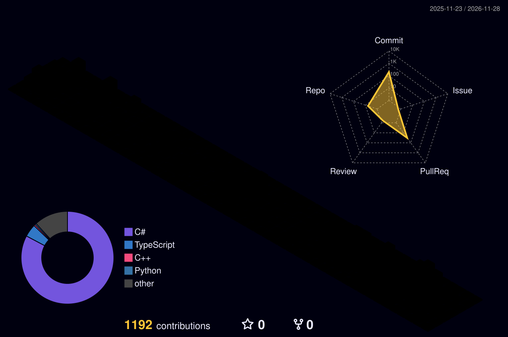

  <h1>João Victor Brayner</h1>

  

    Desenvolvedor backend
  

<picture>
  <source media="(prefers-color-scheme: dark)" srcset="https://raw.githubusercontent.com/braynerdev/braynerdev/output/github-contribution-grid-snake-dark.svg" />
  <source media="(prefers-color-scheme: light)" srcset="https://raw.githubusercontent.com/braynerdev/braynerdev/output/github-contribution-grid-snake.svg" />
  
</picture>

---

| | |
|---|---|
|  |  |

| | | |
|---|---|---|
|  |  |  |

---

## Tecnologias

  
   
  
  
  

---

## Contato

  
  

